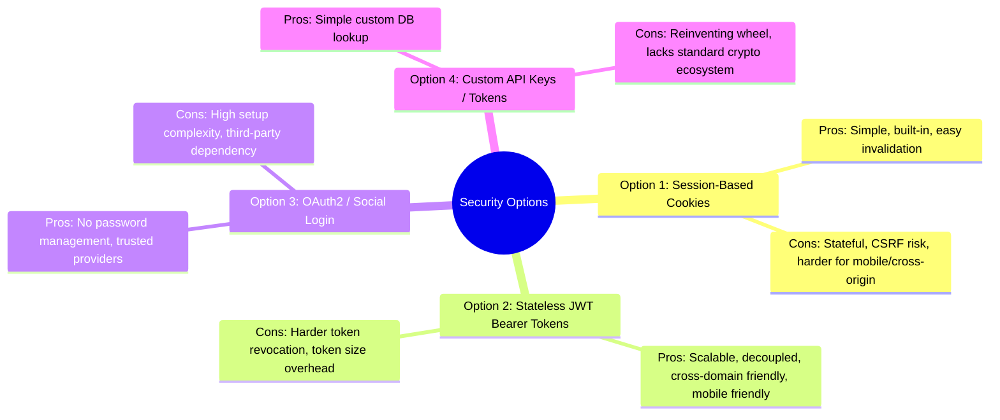
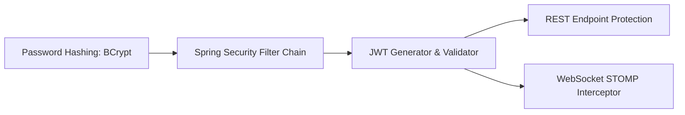

# Chat Application Security Architecture & Implementation Plan

> **Author**: Middleware Engineering Team  
> **Status**: Design & Options Proposal  
> **Project**: `chat-middleware` (Spring Boot 4 / Java 21 / PostgreSQL)

---

## 1. Executive Summary

This document evaluates authentication and security strategies for the `chat-middleware` system. Securing a chat application requires protecting two distinct communication channels:
1. **REST API endpoints** (Account creation, profile updates, history retrieval, group management).
2. **Real-time WebSockets / STOMP connections** (Real-time message streaming, typing indicators, presence).

---

## 2. Authentication Architecture Options & Trade-Off Analysis

---

### Option 1: Session-Based Authentication (Cookies / `JSESSIONID`)

The server creates an in-memory or Redis-backed HTTP session upon login and returns a `Set-Cookie: JSESSIONID=...` with `HttpOnly` and `Secure` flags.

#### Pros:
* ✅ **Simple & Native to Spring Boot**: Built-in support via Spring Session and standard servlet containers.
* ✅ **Instant Session Revocation**: Logging out or banning a user immediately terminates their session on the server.
* ✅ **XSS Immune Storage**: `HttpOnly` cookies cannot be accessed or stolen by malicious JavaScript code.

#### Cons:
* ❌ **CSRF Vulnerability**: Requires robust CSRF token management on every mutating REST request.
* ❌ **Scaling Complexity**: Stateful sessions require sticky sessions or a shared distributed cache (e.g. Redis) if horizontal scaling across multiple servers.
* ❌ **Cross-Domain & Mobile Friction**: Managing cookie lifecycles across separate frontend domains or native mobile apps requires extra CORS/cookie configuration.

---

### Option 2: Stateless JWT (JSON Web Tokens) Bearer Authentication ⭐ *(Recommended)*

Upon login (`POST /users/login`), the server signs a cryptographic JWT containing the user's `userId`, `username`, and roles. The frontend stores this token and passes it in the `Authorization: Bearer <token>` header for REST calls and STOMP connection headers.

#### Pros:
* ✅ **Stateless & Scalable**: The server verifies token signatures mathematically without querying a session database on every request.
* ✅ **SPA & Mobile Friendly**: Perfect for React/Vue/Angular front-ends and mobile apps without cookie cross-origin headaches.
* ✅ **Seamless WebSocket Handshake**: The JWT can be easily sent in the STOMP `CONNECT` frame header (`Authorization: Bearer <token>`) to authenticate the WebSocket session on connect.
* ✅ **No CSRF Risk**: Since tokens are sent in headers rather than ambient browser cookies, CSRF attacks are neutralized.

#### Cons:
* ❌ **Revocation Requires Work**: Because tokens are stateless, an active token remains valid until expiry unless a token blacklist/refresh token mechanism is implemented.
* ❌ **XSS Risk if Stored in LocalStorage**: The client application must store tokens securely (in-memory or secure storage) to mitigate XSS exposure.

---

### Option 3: OAuth2 / Social Login (Google / GitHub / Keycloak)

Users authenticate via third-party providers (Google, GitHub, Discord) using OpenID Connect (OIDC).

#### Pros:
* ✅ **Zero Password Storage Liability**: No need to store passwords or manage password resets.
* ✅ **Frictionless Onboarding**: Users sign in with a single click.

#### Cons:
* ❌ **Overkill for Early-Stage Mentorship**: Requires configuring third-party developer consoles, redirect URIs, and complex callback handling.
* ❌ **External Dependency**: Authentication fails if the third-party OAuth provider is down or unreachable in offline dev environments.

---

### Option 4: Custom Database Token / API Key

Generating a random UUID token on login, storing it in a database table `user_tokens`, and checking it on every request.

#### Pros:
* ✅ Easy to understand conceptually for beginners.

#### Cons:
* ❌ Inefficient: Requires a database hit on every single HTTP and WebSocket request.
* ❌ Non-standard: Bypasses standard Spring Security filter ecosystem and tooling.

---

## 3. Comparison Matrix

| Criteria | Option 1: Sessions / Cookies | Option 2: Stateless JWT (Recommended) | Option 3: OAuth2 / Social | Option 4: Custom DB Token |
| :--- | :--- | :--- | :--- | :--- |
| **Complexity for Mentorship** | Low - Medium | **Medium (Optimal Learning)** | High | Low |
| **WebSocket Compatibility** | Medium | **Excellent** | Good | Fair |
| **Horizontal Scalability** | Low (needs Redis) | **High (Stateless)** | High | Low (DB bottleneck) |
| **SPA / Mobile Alignment** | Medium | **Excellent** | Excellent | Good |
| **Security Industry Standard** | Standard | **Standard** | Standard | Non-Standard |

---

## 4. Recommended Implementation Strategy for the Mentorship Project

We recommend **Option 2 (Stateless JWT Authentication with BCrypt Password Hashing)**. It strikes the perfect balance between teaching modern industry-standard patterns and keeping the codebase maintainable.

### Core Security Pillars:

### Pillar 1: BCrypt Password Hashing
* Never store plain text passwords in the `users` table.
* Use `BCryptPasswordEncoder` (cost factor 10 or 12).
* Automatically hashes passwords before persisting in `UserDao.save(...)` and uses `passwordEncoder.matches(raw, encoded)` on login.

### Pillar 2: Jackson Serialization Protection
* Passwords have already been annotated with `@JsonProperty(access = JsonProperty.Access.WRITE_ONLY)` on [`Users.java`](file:///home/james/Documents/Mentorship/chat-room/chat-middleware/src/main/java/com/example/chat_middleware/dao/entities/Users.java) to prevent password leakage in HTTP responses.

### Pillar 3: Spring Security Filter Chain & JWT Verification
* Unprotected Public Endpoints:
  * `POST /users/add` (Registration)
  * `POST /users/login` (Authentication)
  * `GET /users/check-username` (Availability check)
* Protected Endpoints (Require Bearer Token):
  * All `/messages/**`, `/conversations/**`, `/groups/**`, `/friends/**` endpoints.

### Pillar 4: WebSocket Connection Authentication
* Intercept the STOMP `CONNECT` frame using a `ChannelInterceptor`.
* Extract the JWT token from the `Authorization` header in the STOMP handshake.
* Authenticate the WebSocket session so messages sent across WebSockets identify the verified user.

---

## 5. Step-by-Step Implementation Roadmap

1. **Enable Spring Security Starter**:
   * Uncomment `spring-boot-starter-security` in `pom.xml`.
   * Add `jjwt-api`, `jjwt-impl`, and `jjwt-jackson` (or `nimbus-jose-jwt`) dependencies for JWT generation.

2. **Create `SecurityConfig`**:
   * Define `SecurityFilterChain` bean.
   * Configure CORS (`CorsConfigurationSource`) for front-end origin access.
   * Disable CSRF (safe for stateless JWT).
   * Define `BCryptPasswordEncoder` bean.

3. **Create `JwtUtil` / `JwtTokenProvider`**:
   * `generateToken(Users user)`: Signs a token valid for e.g. 24 hours.
   * `validateToken(String token)`: Validates signature and expiration.
   * `getUserIdFromToken(String token)`: Extracts user UUID.

4. **Create `JwtAuthenticationFilter`**:
   * Extends `OncePerRequestFilter`.
   * Extracts Bearer token from `Authorization` header, validates it, and sets `SecurityContextHolder.getContext().setAuthentication(...)`.

5. **Create `WebSocketSecurityConfig`**:
   * Add `ChannelInterceptor` on client inbound channel to validate JWT tokens on STOMP `CONNECT`.
