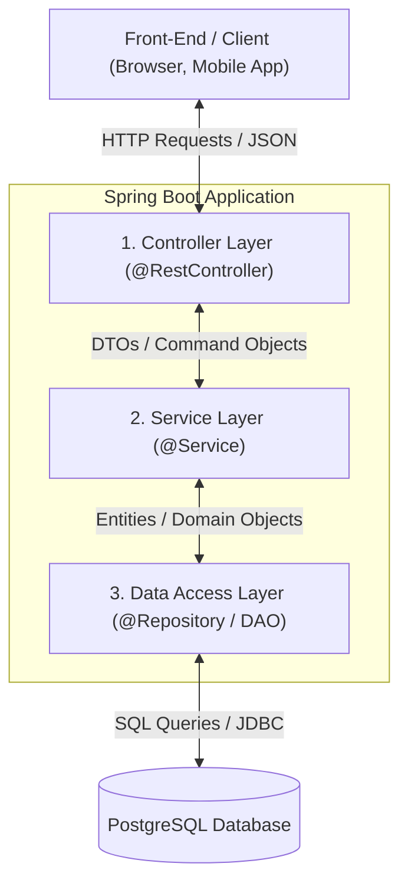
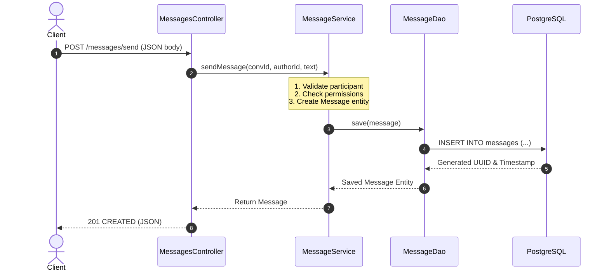

# Complete Guide: Understanding & Building the Service Layer in Spring Boot

> **Target Audience**: Students and developers transitioning to multi-tier backend architectures.  
> **Project Context**: `chat-middleware` (Spring Boot 4 / Java 21 / PostgreSQL / Spring Data JPA)

---

## 1. What is the Service Layer?

In a standard Spring Boot enterprise web application, code is organized into **Three Core Layers** (plus the Database):



1. **Controller Layer (`@RestController`)**: Handles HTTP requests, parses query parameters/JSON bodies, returns HTTP status codes (200 OK, 404 NOT FOUND), and coordinates input/output.
2. **Service Layer (`@Service`)**: **The "Brain" of the application**. Implements business rules, orchestrates complex workflows across multiple DAOs, manages database transactions (`@Transactional`), validates permissions, and handles business errors.
3. **Data Access Layer (`@Repository` / DAO)**: Communicates directly with the database via JPA/Hibernate to run CRUD operations and queries.

---

## 2. Why Can't the Controller Call the DAO Directly?

When starting out, it is tempting to put all code directly inside the Controller (like saving directly to `UserDao`). While this works for tiny prototype scripts, it creates severe problems in real applications:

| Problem | Calling DAOs Directly in Controller | Using a Dedicated Service Layer |
| :--- | :--- | :--- |
| **Business Logic Location** | Scattered across multiple endpoints; duplicated in every controller. | Centralized in one reusable place. |
| **Transaction Management** | If creating a chat requires saving 3 entities and the 3rd fails, the DB is left in a corrupted/half-saved state. | `@Transactional` ensures all steps succeed or everything automatically rolls back. |
| **Reusability** | Logic in `MessagesController` cannot be reused by a WebSocket listener, scheduled cron job, or command-line runner. | Any controller, WebSocket handler, or background task can invoke `MessageService`. |
| **Security & Permissions** | Hardcoded checks in every HTTP handler. | Centralized authorization rules (e.g., *"Is user X an admin of group Y?"*). |
| **Testing** | Hard to test because you must mock HTTP requests and MVC infrastructure. | Plain Java unit tests without HTTP overhead. |

---

## 3. What Does a Service Class Actually Do? (Key Responsibilities)

### 1. Business Logic & Validation
* *Example*: A user cannot send a message to a conversation they are not a member of.
* *Example*: A user cannot accept a friend request that was sent to someone else.

### 2. Transaction Management (`@Transactional`)
* When an operation involves **multiple database writes**, all writes must either succeed together or fail together (Atomicity).
* *Example*: Creating a direct conversation requires:
  1. Saving a new `Conversations` record.
  2. Saving a `UserConversations` record for User 1.
  3. Saving a `UserConversations` record for User 2.
  If step 3 crashes, `@Transactional` automatically undoes steps 1 and 2 so orphaned data is never left behind.

### 3. DTO (Data Transfer Object) Conversion
* Protects database entities from being directly exposed to clients.
* Omits sensitive data (e.g., password hashes) and adds computed fields (e.g., `unreadMessageCount`).

### 4. Cross-DAO Orchestration
* A single business action often needs multiple DAOs.
* *Example*: Sending a message might use `ConversationDao`, `UserDao`, `MessageDao`, and `MessageEditDao`.

### 5. Side Effects & Integrations
* Triggering WebSocket broadcasts to online clients.
* Sending push notifications or email alerts.
* Recording security audit logs.

---

## 4. Concrete Examples from Our Chat Application

### Example 1: Sending a Message (`MessageService`)

```java
@Service
public class MessageService {

    @Autowired
    private MessageDao messageDao;

    @Autowired
    private ConversationDao conversationDao;

    @Autowired
    private UserDao userDao;

    @Autowired
    private UserConversationDao userConversationDao;

    @Transactional
    public Messages sendMessage(UUID conversationId, UUID authorId, String text, UUID replyToId) {
        // 1. Business Rule: Validate author exists
        Users author = userDao.findById(authorId)
            .orElseThrow(() -> new ResourceNotFoundException("Author not found"));

        // 2. Business Rule: Validate conversation exists
        Conversations conversation = conversationDao.findById(conversationId)
            .orElseThrow(() -> new ResourceNotFoundException("Conversation not found"));

        // 3. Security/Membership Rule: Verify author is a participant
        boolean isParticipant = userConversationDao.existsByUser_IdAndConversation_Id(authorId, conversationId);
        if (!isParticipant) {
            throw new AccessDeniedException("User is not a participant in this conversation");
        }

        // 4. Optional Thread Reply handling
        Messages replyTo = null;
        if (replyToId != null) {
            replyTo = messageDao.findById(replyToId)
                .orElseThrow(() -> new ResourceNotFoundException("Reply parent message not found"));
        }

        // 5. Construct and Persist Entity
        Messages message = new Messages();
        message.setConversation(conversation);
        message.setAuthor(author);
        message.setMessageContents(text);
        message.setTime(Instant.now());
        message.setReplyTo(replyTo);

        Messages savedMessage = messageDao.save(message);

        // 6. (Optional Future Step) Trigger WebSocket broadcast:
        // webSocketMessagingTemplate.convertAndSend("/topic/conversation/" + conversationId, savedMessage);

        return savedMessage;
    }
}
```

---

### Example 2: Creating a 1-on-1 Direct Conversation (`ConversationService`)

```java
@Service
public class ConversationService {

    @Autowired
    private ConversationDao conversationDao;

    @Autowired
    private UserDao userDao;

    @Autowired
    private UserConversationDao userConversationDao;

    @Transactional
    public Conversations getOrCreateDirectConversation(UUID user1Id, UUID user2Id) {
        if (user1Id.equals(user2Id)) {
            throw new IllegalArgumentException("Cannot create a direct conversation with yourself");
        }

        // Check if conversation already exists (Idempotency)
        Optional<Conversations> existing = conversationDao.findDirectConversationBetween(user1Id, user2Id);
        if (existing.isPresent()) {
            return existing.get();
        }

        Users user1 = userDao.findById(user1Id)
            .orElseThrow(() -> new ResourceNotFoundException("User 1 not found"));
        Users user2 = userDao.findById(user2Id)
            .orElseThrow(() -> new ResourceNotFoundException("User 2 not found"));

        // Step 1: Create Conversation entity
        Conversations conv = new Conversations();
        conv.setConversationName(user1.getUserName() + " & " + user2.getUserName());
        conv.setStartTime(Instant.now());
        conv.setWorldPermissions("PRIVATE");
        Conversations savedConv = conversationDao.save(conv);

        // Step 2: Add User 1 membership
        UserConversations uc1 = new UserConversations();
        uc1.setUser(user1);
        uc1.setConversation(savedConv);
        userConversationDao.save(uc1);

        // Step 3: Add User 2 membership
        UserConversations uc2 = new UserConversations();
        uc2.setUser(user2);
        uc2.setConversation(savedConv);
        userConversationDao.save(uc2);

        return savedConv;
    }
}
```

---

## 5. Step-by-Step Guide for Students: How to Build a Service

1. **Create the Service Class**: Place it in `com.example.chat_middleware.services`.
2. **Add Spring's `@Service` Annotation**: Tells Spring to manage this class as an injectable singleton bean.
3. **Inject Required DAOs**: Use constructor injection or `@Autowired` for DAOs needed by the service.
4. **Annotate Mutating Methods with `@Transactional`**: Add `@Transactional` from `org.springframework.transaction.annotation.Transactional` to methods that perform inserts, updates, or deletes.
5. **Throw Meaningful Exceptions**: If a validation check fails, throw standard or custom exceptions (e.g. `IllegalArgumentException`, `EntityNotFoundException`) instead of silently failing or returning null.
6. **Inject the Service into the Controller**: Replace DAO injections in your `@RestController` with the new `@Service` class.


